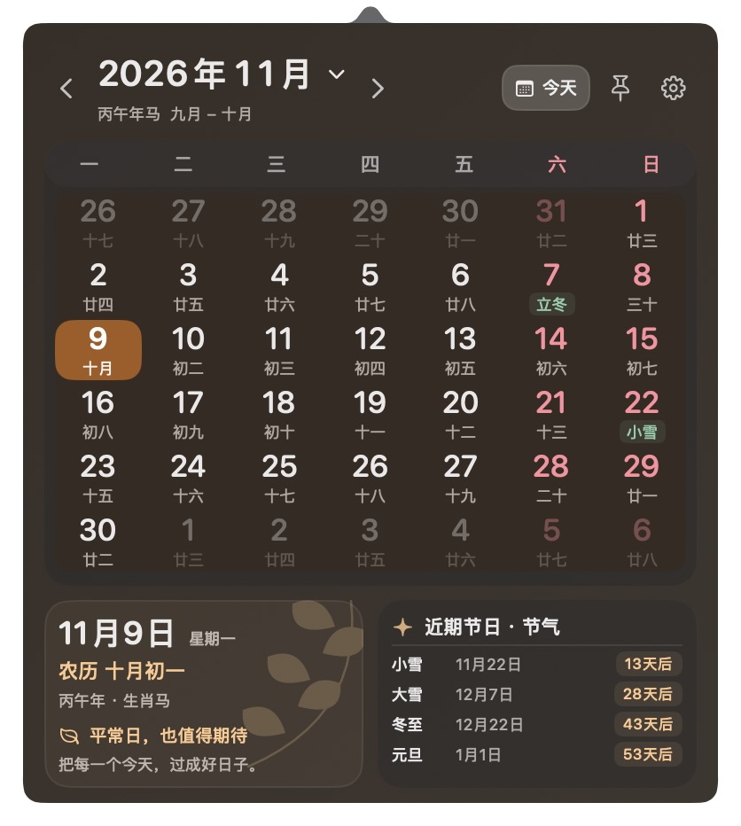
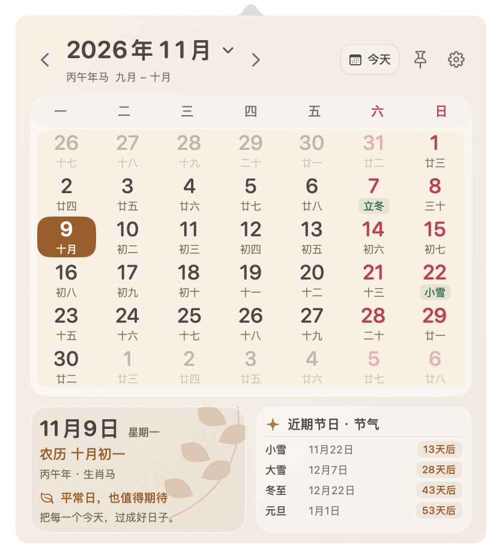
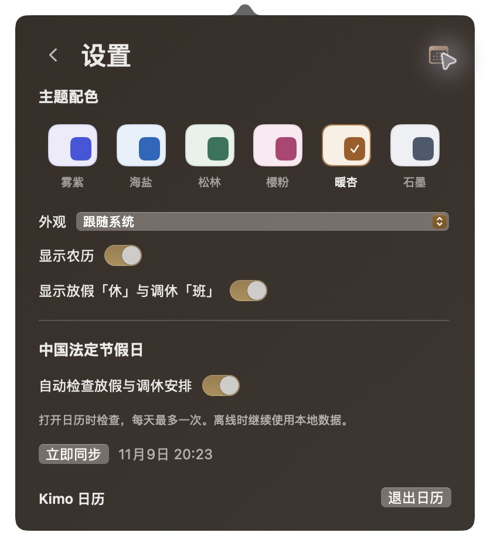

# Kimo 日历

一款原生 macOS 菜单栏日历，支持农历、法定节假日、跟手翻月和待办提醒。

使用 SwiftUI + AppKit 构建，无第三方运行时依赖。平时停留在菜单栏，点击当天日期即可展开 **392 × 440 pt** 的紧凑面板。

[下载 macOS 预览版](https://github.com/kimo-si/kimo-calendar/releases/latest) · [使用方法](#使用方法) · [从源码构建](#从源码构建)

## 界面预览

以下为应用真实界面截图。

| 深色外观 | 浅色外观 |
| --- | --- |
|  |  |

<details>
<summary>查看主题与设置</summary>



</details>

## 功能

| 功能 | 说明 |
| --- | --- |
| 菜单栏日历 | 圆角边框内显示当天日号，深浅背景自动适配，跨午夜自动更新 |
| 农历与节气 | 农历、闰月、干支年、生肖、传统节日、二十四节气及近期节日倒计时 |
| 法定节假日 | 显示放假「休」和调休「班」，支持联网更新与离线缓存 |
| 跟手侧滑 | 像手机桌面一样拖动月份，相邻页逐步露出，松手后吸附；短拖归位，快速轻扫翻页 |
| 多主题 | 雾紫、海盐、松林、樱粉、暖杏、石墨，支持浅色、深色和跟随系统 |
| 日期待办 | 双击日期打开清单，支持添加、编辑、删除、完成与恢复 |
| 系统提醒 | 设定提醒时间，使用 macOS 通知；通知中可完成事项或延后 10 分钟 |
| 原生交互 | 菜单栏弹出与收起动画、置顶、年月跳转、快捷键和可选登录启动 |

## 下载与安装

从 [Releases](https://github.com/kimo-si/kimo-calendar/releases/latest) 下载 `KimoCalendar-macOS.zip`，解压后将 **Kimo 日历.app** 放入「应用程序」，再打开应用。

- 最低部署目标：**macOS 14**。
- 当前预编译包适用于 **Apple Silicon（arm64）**。
- 当前为本地临时签名的预览版，**尚未进行 Apple 公证**。如系统阻止打开，可在系统设置的「隐私与安全性」中按系统提示处理，或自行从源码构建。
- 没有 Windows、Linux 或移动端版本。

## 使用方法

1. 点击菜单栏日期图标展开日历；收起后重新打开，会直接回到今天。
2. 左滑进入下个月，右滑返回上个月。触控板、鼠标横向拖动、左右箭头按钮和方向键均可翻页。
3. 单击日期立即选中；双击打开当天待办。鼠标悬停日期不显示提示语。
4. 点击年月选择月份，点击「今天」或按 `⌘T` 返回今天。
5. 点击图钉保持面板打开；右键菜单栏图标可退出。

浏览其他月份时不会自动选中同号日期。月份采用固定六周布局，星期栏和底部日期信息保持固定。

### 待办与通知

双击某一天，输入标题并按回车或点击「添加」。已完成事项保留在当日清单，可以恢复；日期左上角的小圆点表示存在未完成事项。

「到时提醒」默认关闭。开启后可选择该日期的具体时间，首次主动设置提醒时申请系统通知权限。保存过去的提醒时间会显示错误，并保留输入内容。

通知支持「完成」与「10分钟后提醒」，点击通知正文会定位到对应日期。完成或删除事项会撤销相关提醒。通知被拒绝或安排失败时，待办仍会保存在本地，并显示真实状态。

设置中的「待办提醒」提供授权状态、系统通知设置入口、重新安排提醒和 5 秒测试通知。横幅、声音及睡眠后的投递时机由 macOS 通知设置和专注模式管理。

### 主题与外观

在设置中选择六种主题，外观可独立设为浅色、深色或跟随系统。偏好会自动保存。系统开启「减少动态效果」时，应用减少页面运动。

## 放假与调休数据

使用 [NateScarlet/holiday-cn](https://github.com/NateScarlet/holiday-cn) 按国务院公告整理的年度数据。应用内可查看数据来源及原始公告；数据的 MIT 许可副本随资源保留，见 [第三方数据许可](Sources/KimoCalendar/Resources/Holidays/LICENSE.txt)。

- 内置 2025、2026、2027 年已公告安排。
- 打开面板时检查当前年份及前后各一年；每年自动检查间隔为 24 小时，也可手动同步。
- 优先显示本地数据，后台更新；主站失败后尝试 jsDelivr 镜像，网络异常时继续使用有效缓存。
- 「休」仅表示公告中的放假日期，「班」表示调休上班。传统节日和节气本身不代表法定放假。
- 未取得正式公告的年份会在设置中说明，数据异常不会覆盖有效缓存。

日期遵循系统当地时区。农历使用 Foundation 中国历法；节气为太阳视黄经近似计算，接近午夜时可能有日期误差，法定放假安排始终独立使用公告数据。

## 本地数据与性能

待办保存在 `~/Library/Application Support/KimoCalendar/todos.sqlite3`，无需注册账号或上传待办。使用系统 SQLite、WAL 和事务，后台串行访问；数据库提交后再安排通知。

节假日缓存位于 `~/Library/Caches/com.kimo.calendar/holidays/`，最近五个年度文件保留在内存中。节假日同步会访问上述公开数据源，待办提醒使用系统本地通知。

- 只缓存当前和相邻两个日历月，拖动期间不计算农历、不访问磁盘。
- 页面共用一个横向位移，松手后完成吸附再提交月份；连续翻页按序处理。
- 收起面板后释放视图及滚动监听。
- 无每秒或每分钟轮询，仅保留一个定位到下个午夜的单次计时器，并订阅系统跨日、唤醒及时间变化通知。

验证范围与平台限制见 [VALIDATION.md](VALIDATION.md)。

## 从源码构建

需要 macOS 和包含 **Swift 6.2 或更新工具链**的 Xcode。本项目已在 Apple Silicon、macOS 27.0.1、Swift 6.4 环境验证。

```sh
git clone https://github.com/kimo-si/kimo-calendar.git
cd kimo-calendar
bash scripts/build-app.sh
open "dist/Kimo 日历.app"
```

构建脚本生成 Release 应用、图标、资源包并执行本地签名，默认按当前 Mac 架构构建。其他处理器及实际 macOS 14 设备尚未验收。

### 开发与检查

```sh
swift test --configuration release
xcrun swift-format lint --strict --recursive Sources Tests scripts/make-icon.swift Package.swift
bash -n scripts/build-app.sh
plutil -lint assets/Info.plist
```

开发预览使用独立窗口：

```sh
swift run KimoCalendar --preview
swift run KimoCalendar --preview --date 2026-11-09
```

命令行预览不具备系统应用通知身份，测试通知请使用打包后的 `.app`。

## 目录结构

```text
Sources/
  KimoCalendar/           菜单栏、展示状态、主题和原生界面
  KimoCalendarCore/       历法、手势、节假日同步、SQLite 与提醒协调
Tests/                   离线自动测试
assets/                  应用配置
scripts/                 应用及图标构建脚本
docs/screenshots/        实际界面截图
```

构建缓存、应用成品、本地数据库和日志不纳入 Git。下载成品请使用 Releases，源代码仓库中不包含 `dist/`。
